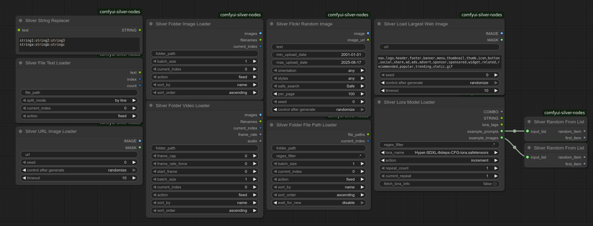

# ComfyUI Silver Nodes

A collection of utility nodes for ComfyUI that enhance workflow capabilities with advanced loaders and processing tools.



## Features

Silver Nodes provides several specialized nodes designed to improve your ComfyUI workflows:

### Loading Nodes

#### Silver URL Image Loader
Load images directly from URLs with cache busting and duplicate prevention. Designed to work with /random/ URLs for img2img processing.
- **Features**:
  - Cache busting with random query parameters to prevent caching
  - Duplicate detection using content hashing
  - Retry mechanism for failed downloads (5 attempts by default)
  - Supports common image formats (JPEG, PNG, WebP, etc.)
  - Tracks previously loaded images to avoid duplicates
  - **Note**: If image loading fails after all retry attempts, the entire workflow execution will be skipped to prevent partial processing

#### Silver Web Image Loader
Extract and download images from webpages with smart selection. Optimized for /random/ URL endpoints that serve random images.
- **Features**:
  - Analyzes webpage for images with size information
  - Filters out non-content images (icons, buttons, logos, ads, etc.)
  - Handles lazy-loaded images and responsive designs
  - Note: "Largest" is determined by HTML attributes, not actual download size

#### Silver Folder Image Loader
Load images from folders with advanced sorting and batching.
- **Features**:
  - Batch loading of multiple images
  - Sorting by name, date modified, or file size
  - Sequential or random access patterns
  - Recursive directory scanning
  - Image format detection and filtering

#### Silver Folder Video Loader
Load and process video frames with audio extraction.
- **Features**:
  - Frame extraction with configurable frame rate
  - Audio track extraction
  - Support for common video formats (MP4, AVI, MOV, etc.)
  - Frame skipping and batching
  - Memory-efficient processing

#### Silver File Text Loader (Beta)
Load and process text files with encoding detection.

> ⚠️ **Note**: This node is currently in beta and has not been fully tested. Some edge cases may not be handled correctly.

- **Features**:
  - Automatic encoding detection
  - Support for multiple text formats (TXT, JSON, CSV, etc.)
  - Line or paragraph splitting
  - Large file handling
  - Error handling for malformed files

#### Silver Folder File Path Loader
Get file paths from folders with regex filtering.
- **Features**:
  - Recursive directory scanning
  - Regex pattern matching
  - Sorting and filtering options
  - Batch processing support
  - File type filtering

### Processing Nodes
- **Silver String Replacer**: Perform text replacements using pattern matching with support for random selection from multiple alternatives
- **Silver Lora Model Loader**: Advanced LORA model loading with filtering and cycling

### Media Nodes

#### Silver Flickr Random Image
Fetch random images from Flickr based on search criteria.
- **Features**:
  - Search by keywords, date ranges, and orientation
  - Safe search filtering
  - Duplicate prevention
  - Configurable image quality
  - Attribution handling
- **Requirements**:
  - Requires a valid Flickr API key
  - Respects Flickr's rate limits
  - Includes proper attribution in output

### Sampling Nodes

- **Silver H3 Staged Multishot**: Long-form MiniMax-H3 video+audio sampler - encode once, sample once, decode once (detailed section below)

### Core Features

- **Resource Management**: Memory-efficient loading with configurable caching and automatic cleanup
- **Batch Processing**: Parallel processing with progress tracking and memory monitoring
- **Sequential Processing**: Multiple iteration strategies with state preservation
- **Sorting Options**: Sort by various file attributes with natural sorting support
- **Error Handling**: Graceful degradation with detailed logging and retry mechanisms

## Installation

1. Clone this repository into your ComfyUI `custom_nodes` directory:
   ```bash
   cd ComfyUI/custom_nodes
   git clone https://github.com/yourusername/comfyui-silver-nodes.git
   ```
   
2. Restart ComfyUI

## Nodes

### Silver H3 Staged vs Silver H3 Batch

Both nodes share the same staging backbone - text encoder, DiT and the video/audio VAEs each load **exactly once** for the whole run - but they are built for different jobs:

| | Staged Multishot | Batch |
|---|---|---|
| Output | **ONE continuous long-form take** | **N independent clips** |
| Prompts | N scenes of the same take | N unrelated videos |
| Inter-shot continuity | join keyframes / latent handoff, audio lock, onset guard | none - clips share nothing |
| Re-rolling | whole chain (deterministic start-to-finish) | any single clip |
| Generation time per entry | slightly higher - handoff injection adds per-step ops | baseline |

**Staged** chains its shots into a single video: each shot re-wakes inside the previous tail latent (`latent_handoff`, the default) or, when a `start_image` is provided, opens on the previous shot's *actual last frame* (native keyframe channel); the audio spine is locked across every join, and the seams are trimmed and crossfaded into one master. It is the "do it right" long-form tool - continuity is engineered in - at the price of coupled, slightly more expensive shots that cannot be re-rendered independently (a bad shot 3 means re-running the chain).

**Batch** renders N standalone videos from N independent prompts with the same one-load-each discipline, so a 12-clip batch costs **~2 model swaps instead of ~3 x 12**. It is the cheaper long-form approximation when roughly-stable identity is good enough: `combine_videos` stitches the clips frame-to-frame with the raw guide track laid over the whole master, but there is **no cross-shot conditioning**, so each join is a hard cut, not a transition. Any single clip can be re-rolled on its own without touching the others.

> **Rule of thumb**: need a genuinely continuous take (a voice that cannot change, motion that carries through cuts) -> **Staged**. Want maximum output per compute, or independent clips you can re-queue individually -> **Batch**.

### Silver H3 Staged Multishot

A long-form MiniMax-H3 pipeline (video + audio, 24 fps) built around one observation: a naive per-shot chain (encode -> sample -> decode per clip) pays **three model swaps per shot**, because ComfyUI loads the text encoder for conditioning, evicts it for the DiT, then evicts that for the VAE - over and over. This node reorders the work into three phases so the load count is **constant regardless of shot count**.

#### How it works - three phases

| Phase | Models hot | What happens |
|---|---|---|
| **A - ENCODE** | text encoder + video/audio VAE | Every prompt's conditioning is built in ONE text-encoder session. The character reference (image + voice) and shot-1 keyframe are VAE-encoded here, and the optional audio spine is encoded once. One controlled VRAM sweep ends the phase. |
| **B - SAMPLE** | DiT (+ video VAE in first_frame mode) | Every shot is sampled back-to-back. Shots join IN LATENT SPACE or through the native keyframe channel (see continuity modes below). No mid-phase sweeps; the only in-phase VAE touch is a 1-frame plain decode per join (chain frame), which can never evict the DiT. |
| **C - DECODE + SAVE** | VAEs | Each stored latent is decoded and **streamed** straight to disk as it goes - always ONE mp4 per shot (with that shot's audio) plus the combined master. Replayed join heads trimmed, audio seams crossfaded. One shot's frames in RAM at a time, never a full master tensor. |

Strict swap accounting: **latent_handoff = exactly 2 swaps for the whole run** (TE -> DiT -> audio-VAE). `first_frame` additionally keeps the video VAE co-resident with the DiT during Phase B for the 1-frame chain decode (still constant per run, not per shot).

#### Continuity modes

How consecutive shots join. **The mode is implied by the inputs - the `continuity` widget is gone**:

- **`first_frame`** - selected by PROVIDING `start_image`. Each shot opens on the previous shot's *actual last frame* through H3's native keyframe channel (the stock I2V path, chained). The model gets clean re-planning semantics: "here is a picture of frame 0." 1 duplicate frame trimmed per join. Requires decoding the tail of each finished shot (done as a 1-frame plain decode, hot, so the DiT stays resident).
  - **Keyframe/ref interaction**: `model_base.py:2173` overwrites `cond_video_latents` with ref block latents, destroying keyframe conditioning when both are present. A shot that carries a keyframe carries NO character refs: `start_image` + char refs are mutually exclusive, and when both are given the REFS are dropped with a warning (start-image chaining wins), so the keyframe stays clean.
- **`latent_handoff`** (default when NO `start_image`) - zero decode: the previous shot's tail video rows / audio columns are locked into the next shot's trajectory at every sampling step (re-noised to the current sigma inside the packed stream). The new shot literally wakes up inside its own previous state - motion, exposure and speech carry. The replayed head (5+17x repeated rows) is regenerated and trimmed on join.

Why there is no "first_frame without decoding": H3's video latent mixes ~3.4 frames into each latent row (5 frames across 2 bootstrap rows, then 17 frames per 5-row block), pooled causally - the final frame has no isolated latent representation. The keyframe slot also expects an *image-mode* latent positioned outside the target timeline, while tail rows are continuation state. Converting between those regimes requires pixels; latent_handoff simply skips the keyframe channel instead.

| | first_frame | latent_handoff |
|---|---|---|
| Join mechanism | native keyframe channel | per-step noise-domain lock |
| Model semantics | re-planning from a still | continuation of prior state |
| VAE touches during sampling | 1-frame plain decode per join | none |
| Trim per join | 1 duplicate frame | 73-frame overlap |

#### Character references (`char_refs_all` / `char_refs_index`)

Two optional IMAGE lists, each encoded once in Phase A and ridden through **both** ref2va channels:

- `char_refs_all` — EVERY image rides EVERY shot (stable `<Picture N>` labels).
- `char_refs_index` — image `i` rides SHOT `i` (a list shorter than the shots reuses its last image for the rest); labels shift per shot.

Both can be connected at once (deduped). Connecting neither = no refs. Each image gives:

- a DiT-side image ref row (`minimax_refs`) - spatial identity without any temporal claim, so it never fights the join keyframes the way a start-frame copy would;
- `<Picture N>` vision tokens spliced into every applicable shot's text conditioning - semantic grounding through the text encoder.

Aspect preserved: downscaled toward the generation's pixel area (stock policy), never stretched onto the canvas grid. Works on shot 1 when no prior shots exist.

> **Note**: refs are **mutually exclusive with `start_image`** - when the latter is given, ALL character refs (images + voice) are dropped with a warning, before any VAE encoding (they share `cond_video_latents`; see the keyframe/ref interaction note above).

#### Character voice reference (`char_audio`)

One voice, encoded once in Phase A (the same audio-VAE session as the spine) and ridden by EVERY shot through **both** ref2va channels:

- a DiT-side audio ref row (`minimax_refs`, `ref_audio_t` + `audio_latent`) - voice/style identity with no timing claim, so it never fights `guide_audio` (the driving spine) or the generated speech;
- `<Audio N>` tokens spliced into every shot's text conditioning, in the reference node's fixed order (images first, then standalone audio) so the labels stay in sync with the DiT's ref rows.

Single track (`[:1]`, reused for every shot). Any sample rate; mono is upmixed. Dropped (with the warning above) when `start_image` rides.

#### Audio spine (`guide_audio`)

A continuous audio track for the WHOLE take (voice recording, song, low-res long pass). Encoded ONCE in Phase A; every shot's entire audio stream is then locked to its time-slice of the spine at every sampling step - the video follows the locked audio (lips included) and the voice cannot change between shots. Shot stride accounts for the join trim so the spine stays in sync. A spine shorter than the run degrades gracefully: partial coverage locks the covered prefix, exhausted coverage improvises freely. Any sample rate; mono is upmixed.

#### Join mechanics

- **Trim**: shots 2+ drop their replayed head on decode (1 frame in FF, 22 in LH); the latent outputs carry the WRONG head - only the trimmed decoded mp4s / `_master.mp4` are correct to use.
- **Seam bleed** (`latent_handoff_taper`): percent of each shot that carries the previous shot's motion as a linear fade (15% default = 1.5s of a 10s clip; 0 = hard seam). This makes the seam CONTINUE - the cut stays invisible - it does NOT create a transition. The locked boot rows (~0.9s of exact continuation) plus the fade mean each shot opens with a few seconds of previous action carrying through, then the new description takes over by relay - the point of a long continuous take. **Scene transitions are prompt-authored, not mechanical**: if a shot's prompt opens with its own transition, drop this toward 0-5% so stale motion doesn't fight the described cut. Injection runs while sigma > 0.30 (fixed in the backend), so late detail steps are free to reconcile.
- **Audio lock** (`audio_lock`): ON = the next shot's audio head is a locked replay of the previous tail, dropped symmetrically on decode. OFF = silent-join: the new head is kept in full and the PREVIOUS tail is trimmed instead (with a fade-out) - script each shot to land its line and hold still for the last beat.
- **Onset guard** (`audio_onset_guard`): appends the quietest ~0.4s of the previous shot's audio latent just past the locked span so the model cannot plan speech under the replay.
- **Assembly**: each shot's frames are muxed straight into the master mp4 as they decode; cosine crossfade welds the audio seams.
- **Streamed save** (matches the Batch node's save process): the whole take always lands in a DATED `prefix_yyyymmddHHMMSS/` subfolder as ONE mp4 per shot (`shot_01.mp4`, `shot_02`... - each with that shot's own audio) PLUS the combined `_master.mp4` (H.264 + AAC fixed at 24 fps - the model's audio-sync rate; `format`/`frame_compression` controls). Each shot is saved to its own file the moment it decodes and freed, so at most one shot's frames are ever in RAM - a very long take's progress survives even if a later shot fails (the per-shot files stay on disk for manual re-combining), instead of the old single-file path that could overload RAM and lose everything.

#### VRAM & model management notes

- Sweeps happen only at phase boundaries, never mid-phase.
- The only in-phase VAE decode is the 1-frame chain frame per join: a plain full-clip decode would make model management reserve the whole clip's footprint and evict the resident DiT. Full shots are decoded once, in Phase C, streamed and freed immediately.
- No `soft_empty_cache()` between shots: it releases warm weight pages on DynamicVRAM/arena setups and would cost a full remap per shot.
- Verbose `[SilverH3][dbg]` forensics are currently compiled in (`_DBG = True`) for the shot-2 color-block investigation; expect extra log lines.

#### Inputs

Required: `model`, `clip`, `video_vae`, `audio_vae`, `prompts`, `overall_prompt`, `width`, `height`, `frames_per_shot` (17k+5 grid at 24 fps; trained range ~124-362), `seed`, `steps`, `sampler_name`, `scheduler`.

Optional: `start_image` (I2V first frame of shot 1), `latent_handoff_taper`, `audio_onset_guard`, `audio_lock`, `context_frames` (multi-frame temporal context, default 5), `pin_renorm` (latent std normalisation, default ON), `color_reanchor` (colour stabilisation + seam match, default ON), `seed_per_shot`, `guide_audio`, `char_refs_all`, `char_refs_index`, `char_audio`, `filename_prefix`, `format`, `frame_compression`, `double_pass` (refine pass), `double_pass_denoise`, `double_pass_steps`, `upscale_factor` (latent upscale before decode).

#### Outputs

1. `master_audio` - master audio at the audio VAE's rate, assembled + crossfaded at the seams
2. `saved_video` - path of the combined `_master.mp4` (the take is written to disk, per-shot files alongside, not held in RAM as frames)

#### Prompt format

Identical to the Batch node: ONE master prompt in `overall_prompt` (prepended to EVERY shot => `"overall shot"`), plus a `prompts` STRING_LIST with one prompt PER SHOT. A plain string is accepted as a 1-shot list; blank entries are skipped. Feed the list from the **Silver H3 Line Batch** (`SilverH3PromptsBuilder`) or **Silver H3 Prompt List** (`SilverH3PromptListBuilder`) node, or wire a `STRING_LIST` straight in.

### Silver H3 Batch

Render **N independent** MiniMax-H3 videos (video + audio, 24 fps) from N independent prompts, keeping the same swap-minimising discipline as the staged multishot: the text encoder, DiT and VAE each load **exactly once** for the whole batch (2 model swaps total instead of ~3 x N). Every prompt is text-encoded in one TE session; the optional start/end keyframes and character refs (image + voice) are VAE-encoded once and reused; every video is sampled back-to-back with the DiT resident; every latent is decoded in one VAE session.

#### Model requirements

- **`start_image`** drives H3's native **first/last keyframe** channel (the last frame is derived from the next start image when `combine_videos` is on). Use an **fl2v-capable** (first/last-to-video) model when you supply start frames - a plain t2v model will ignore the keyframes.
- **`char_refs_index`** rides H3's **ref2va** reference channel (DiT-side image ref rows plus `<Picture N>` vision tokens), INDEXED BY CLIP: image `i` rides clip `i` (image `i+1` too when `combine_videos` is on, so the zoom/pose transition reads continuous). Use a model that supports **reference-to-video (ref2v)** for character identity to take effect.
- **`char_refs_all`** rides the same **ref2va** channel as an **apply-to-all** list: EVERY image in it rides EVERY clip with stable `<Picture N>` labels. Both lists can be connected at once (deduped).
- **`char_audio`** rides the same **ref2va** channel as a single standalone audio ref (`<Audio N>` tokens + a DiT-side audio ref row), one voice shared by every clip. Use a **ref2va**/voice-aware model. It carries **voice/style identity with no timing claim** - it never fights `guide_audio` (the driving spine) or the generated speech, so you can give a character a face (via `char_refs_index`/`char_refs_all`) and a voice (via `char_audio`) together.

**Keyframe/ref conflict**: the keyframe pair and the character refs are **mutually exclusive** - when `minimax_refs` is set, `model_base.py:2173` replaces `cond_video_latents` with only the refs' latents and wipes the keyframes. When both `start_image` and character refs are given, the character refs are **dropped with a warning**. An I2V clip cannot carry identity/voice refs, and a ref-driven clip cannot key its open frame.

#### Keyframe / chaining behaviour

- `start_image` is an **IMAGE batch**. Image `i` is the first frame of clip `i`, so feeding **N+1 images chains N clips frame-to-frame** (image 2 = end of clip 1 = start of clip 2) - the natural "keyframes -> long-form video" workflow.
- A **single** image (batch size 1) is reused as the start frame for every clip.
- The **number of clips is the prompts list length, never the image count**. If an image batch is shorter than the prompts, its last image is reused for the remaining clips; if longer, the extras are ignored.
- There is **no separate `end_image` input**. When `combine_videos` is ON, clip `i`'s LAST frame is automatically taken as image `i+1` (the next clip's start frame) and applied as a `frame_count-1` keyframe - that is what stitches the clips seamlessly. When `combine_videos` is OFF, each clip is a standalone I2V take from its own start frame only (no end keyframe).

#### Other inputs

- `prompts` - one per video (e.g. the Silver H3 Line Batch builder). Empty entries skipped.
- `overall_prompt` - prepended to every video's prompt.
- `char_refs_all` - one or more identity images that ride **every** clip (stable labels). Encoded once in Phase A.
- `char_refs_index` - identity images **indexed by clip**: image `i` rides clip `i` (image `i+1` too when combining); a list shorter than the prompts reuses its last image. **Keyframe conflict**: when `start_image` is given, ALL character refs (images + voice) are dropped with a warning, before any VAE encoding - `minimax_refs` replaces `cond_video_latents` and wipes the keyframes.
- `char_audio` - ONE voice, ridden by every clip (first entry used if a batch is supplied). Encoded once in Phase A, ridden via ref2va as `<Audio N>` + a DiT-side audio ref row. Any sample rate; mono is upmixed. Also dropped when `start_image` rides (see above).
- `guide_audio` / `step_guide_audio` - a continuous audio spine locked per clip. Each clip is generated against its spine slice; a clip without a guide produces its own AV audio. When `combine_videos` is ON **and** `guide_audio` is supplied, the saved master file's audio is the raw full guide track, unprocessed, laid over the whole combined video (truncated to its length). Without a guide, the master uses the assembled per-clip audios (crossfaded at the seams). The `audio` output always carries the per-clip audios.
- `seed_per_shot` - vary the seed per clip (default on).
- `combine_videos` (default OFF) - **SAVED FILES only**: ON stitches every clip into **one master** video (frames + the full guide audio, or per-clip audio crossfaded at the seams) saved into a **dated subfolder** `prefix_yyyymmddHHMMSS/` as `clip_01.mp4`, `clip_02.mp4`, ... plus `_master.mp4` - every clip is on disk so you can re-combine manually if needed. OFF (default) saves **one flat file per clip**, the original behaviour.
- `filename_prefix`, `format`, `frame_compression` - standard save controls (always 24 fps).
- **Streamed saves** - each clip is encoded straight to disk as it is decoded and then freed, so at most ONE clip's frames are ever in RAM regardless of batch size (12 clips of ~2.3GB each fit a 25GB box; the old full-master path thrash was ~54GB).

#### Outputs

1. `audio` - list of audio dicts, one per rendered video `[{v1 audio}, {v2 audio}, ...]` (None for silent clips)
2. `saved_videos` - newline-separated saved paths (the clips + master inside the dated subfolder when `combine_videos` is on, else one flat path per clip)
3. `videos_rendered` - how many videos rendered (the prompts list length)

#### Silver H3 Line Batch

Helper for the **Batch / Staged** nodes: paste one prompt per line, emit a sliding window of `batch` lines (essentially unlimited) addressed by `index` x `batch` as a single list that wires straight into either node's `prompts` input - one text box can drive a long queue of batch renders (or one long staged video) just by bumping `index` each run.

#### Silver H3 Prompt List

Also feeds the **Batch / Staged** nodes' `prompts` input: accepts a **plain string OR an existing STRING_LIST** as `string` (a single string becomes a 1-entry list; blank entries dropped) and optionally appends the `append` string as a **new final entry** - so one primary prompt + a secondary prompt here renders two videos.

#### Recommended workflow (long-form keyframe video)

1. **Generate the keyframes.** Produce the start/end images with an image model (e.g. a **Klein 9B** model) - one image per clip boundary, so you end up with **N+1 images** for N clips (image `i+1` is both the end of clip `i` and the start of clip `i+1`).
2. **Write the prompts.** Generate one video prompt per clip with a language model, or write them by hand. Each prompt describes the motion from that clip's start frame to the next image (its end frame).
3. **Batch the images.** Load all the keyframe images and combine them into a single IMAGE batch in order (N+1 images for N clips), then feed that batch to `start_image`.
4. **Run the node.** Pass the prompt list to `prompts` and the image batch to `start_image`. Set `combine_videos` ON so clip `i`'s end frame is auto-taken from image `i+1` and the clips are stitched into one master video; OFF keeps one standalone file per clip (start frame only, no end keyframe).

#### What is NOT supported (yet)

Inputs are deliberately shaped around whole-sheet / positional semantics. These situations are **not** supported:

- **A reference on a specific clip/shot only.** There is no way to attach a character image (or voice) to just clip 3 while leaving 1 and 2 without it. The two supported shapes are `char_refs_index` (image `i` rides clip/shot `i` - a *positional* list, so images 1 and 2 are still consumed) and `char_refs_all` (everything rides everywhere). No sparse/gap targeting, no per-clip on/off.
- **Multiple voices / dialogue.** Only ONE `char_audio` at a time, ridden by every clip/shot. No "Character 1 voice" vs "Character 2 voice" refs, so a two-character conversation can only be driven by prompt text, the `guide_audio` spine, or sampled speech. Audio is never indexed per clip.
- **Sparse `start_image` (gaps).** You cannot key only clip 3. Batch: an image batch shorter than the prompt list **reuses its last image** for the remaining clips (never "no keyframe"); a single image keys every clip. Staged: `start_image` is the first frame of shot 1 only (per-index start frames and the "ease into the next shot's start frame" end-keyframe are not built yet).
- **`start_image` + character refs at once.** They share the `cond_video_latents` slot, so when both are given the character refs (images + voice) are dropped with a warning. No I2V-with-identity combo, either node.
- **Staged per-index start frames / end-keyframe easing** (planned, not built) and arbitrary per-shot identity swaps mid-take (same sparse-targeting gap as above).

### Silver WAN HuMo Batch

Audio-conditioned talking-head / motion clips for the **WAN HuMo** model (e.g. `WAN-RVC-TalkingHed-1.3B`). WAN HuMo consumes audio as conditioning and does **not** generate a track - so the `guide_audio` is REQUIRED: it drives the lips/expression and is the clip's saved audio. Same staging discipline as the H3 Batch: text encoder, audio encoder, DiT and VAE each load once for the whole batch.

- `guide_audio` (required) + `audio_encoder` (required) - the drive track and ComfyUI's Audio Encoder (Load Audio Encoder + Audio Encoder Encode normally feed the native HuMo node; here they're passed straight to this node). Encoded once, windowed per clip.
- `step_audio` - OFF (default) locks every clip to the FIRST window; ON advances clip `i` to window `[i*clip, (i+1)*clip]`. Auto-ON whenever `combine_videos` is ON.
- `ref_image` (optional) - per-clip identity sheet (image `i` -> clip `i`, single image reused). Applied as the model's `reference_latent`.
- `length` - frames per clip (HuMo default 97 = ~4s @ 24fps); `cfg` for CFG guidance on the pos/neg pair.
- `combine_videos` - ON stitches the clips into one master file with the **full guide audio** laid over the whole take; OFF saves one file per clip with its per-clip audio window.
- Outputs: `video_frames`, `audio`, `saved_videos`, `videos_rendered` (per-clip lists plus paths).

### Silver Lora Model Loader

A specialized LoRA model loader that allows cycling through models with various selection strategies.

#### Features

- **Regex Filtering**: Filter LoRA models by name using regular expressions
- **Sequential Selection**: Increment, decrement, or randomize through filtered models
- **Repeat Control**: Apply the same LoRA multiple times before moving to the next

#### Parameters

- `regex_filter`: Regular expression to filter available LoRA models
- `lora_name`: Currently selected LoRA model
- `action`: Selection strategy (fixed, increment, decrement, randomize)
- `repeat_count`: Number of times to use the same LoRA before changing
- `current_repeat`: Current repeat iteration

### Silver Folder Image Loader

Loads images from a specified folder with advanced sorting and selection options.

#### Features

- **Batch Loading**: Load multiple images at once
- **Flexible Sorting**: Sort by name, creation date, modification date, or file size
- **Sort Direction**: Choose ascending or descending order
- **Selection Strategies**: Fixed position, increment, decrement, or wrap-around

#### Parameters

- `folder_path`: Path to the folder containing images
- `batch_size`: Number of images to load at once
- `current_index`: Starting position in the sorted file list
- `action`: Selection strategy (fixed, increment, decrement, increment_wrap, reset)
- `sort_by`: Sorting criterion (name, created, modified, size)
- `sort_order`: Sort direction (ascending, descending)

### Silver File Text Loader

Loads text from files with options for splitting and sequential selection.

#### Features

- **Text Splitting**: Split by line or paragraph
- **Sequential Access**: Increment, decrement, or randomize through text segments

#### Parameters

- `file_path`: Path to the text file
- `split_mode`: How to split the text (by line, by paragraph)
- `current_index`: Current position in the split text
- `action`: Selection strategy (fixed, increment, decrement, randomize)


## Usage Examples

### Cycling Through LoRA Models

1. Add the Silver Lora Model Loader to your workflow
2. Set a regex filter (e.g., "style.*" to match all style LoRAs)
3. Set action to "increment" to cycle through matching models
4. Connect the output to your workflow

### Processing a Folder of Images

1. Add the Silver Folder Image Loader to your workflow
2. Set the folder path containing your images
3. Configure batch size and sorting options
4. Set action to "increment" to process images sequentially
5. Connect the image output to your processing nodes

### Using the String Replacer

The Silver String Replacer node allows you to perform text substitutions with support for random selection from multiple alternatives.

#### Pattern Format

Each replacement rule is defined on a new line in the format:
```
search_term:replacement_1:replacement_2:replacement_3:...
```
- The first part is the text to search for
- Subsequent parts (after colons) are possible replacements
- One replacement is randomly selected when a match is found

#### Example 1: Simple Replacement
```
dog:cat
```
- Replaces all occurrences of "dog" with "cat"

#### Example 2: Multiple Replacements
```
dog:cat:puppy:wolf
```
- Randomly replaces "dog" with either "cat", "puppy", or "wolf"

#### Example 3: Multiple Rules
```
dog:cat:puppy:wolf
house:home:apartment:building
```
- Replaces "dog" with a random animal
- Replaces "house" with a random dwelling

### Using Text Prompts from a File

1. Add the Silver File Text Loader to your workflow
2. Set the path to your text file containing prompts
3. Choose split mode based on how your prompts are formatted
4. Set action to "increment" to use a different prompt each run
5. Connect the text output to your prompt input

## Changelog

### v1.1.0

- **New Node**: `Silver API Text Loader` - Fetch text directly from an API URL with support for extracting nested JSON tags (e.g. `data.prompt`)
- **New Node**: `Silver Stock Random Image` - Pull random stock images from Lorem Picsum, Wikimedia Commons, LoremFlickr, and Unsplash with no API keys required, including duplicate prevention via local history caching
- **New Nodes**: Shared model loaders that keep weights cached across API prompts instead of re-reading from disk every run:
  - `Silver Shared Diffusion Model` - cached UNet/Flux loader (adapted from [ComfyUI-Inspire-Pack](https://github.com/ltdrdata/ComfyUI-Inspire-Pack))
  - `Silver Shared Text Encoder` - cached CLIP/text-encoder loader
  - `Silver Clear Model Cache` - clears all cached models to free RAM
  - **Note**: These two cache loaders also require a companion patch to ComfyUI's `comfy/model_management.py` (adding a `model_key` to loaded model patchers so `LoadedModel.__eq__` can deduplicate separate patcher objects of the same weights). Without it, the same file loaded via different patchers is treated as two distinct models, causing doubled VRAM usage and spurious reloads that defeat the cache.
- **Improvements to Silver Web Image Loader**:
  - Whole path-segment keyword exclusion (no more false positives from substring matches)
  - Referer header for hotlink-protection bypass
  - Exponential-backoff retries for connection issues
  - WEBP and other transparency-heavy formats handled correctly via RGBA conversion
- **Removed**: `Silver Lipsync (Wav2Lip)` placeholder node
- Pinned `opencv-python` dependency for compatibility with ComfyUI's NumPy version

## Credits

- The shared model caching approach in the `Silver Shared Diffusion Model` node is adapted from [ComfyUI-Inspire-Pack](https://github.com/ltdrdata/ComfyUI-Inspire-Pack) by [ltdrdata](https://github.com/ltdrdata). Many thanks for the original work.

## Contributing

Contributions are welcome! Please feel free to submit a Pull Request.